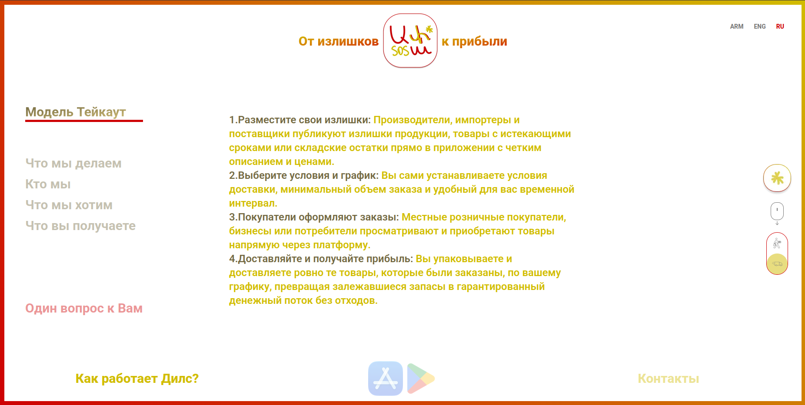

# Appsosa

### 🌐 Live Demo
[https://app-sosa-next.vercel.app/](https://app-sosa-next.vercel.app/)
## О проекте

**Appsosa** — это многоязычный сайт-платформа для бизнеса, помогающая компаниям и продавцам превращать излишки товаров в дополнительную прибыль вместо того, чтобы списывать или выбрасывать их.

Сайт представляет два направления работы:

- **Takeout (Surprise Bags)** — продажа непроданных продуктов питания в специальных наборах («Сюрприз-пакетах») по сниженной цене. Покупатели могут бронировать наборы и забирать их в установленное время.
- **Deals** — площадка для реализации избыточных товарных запасов. Производители, поставщики и импортёры могут размещать товары, а покупатели — оформлять заказы на выгодных условиях.

## Технологический стек

- **Next.js** — React-фреймворк для разработки веб-приложения.
- **React** — создание пользовательского интерфейса и управление компонентами.
- **TypeScript** — типизация и повышение надёжности кода.
- **Tailwind CSS** — стилизация и адаптивная вёрстка.
- **Motion** — анимации, переходы между страницами и интерактивные элементы.
- **Next.js Image** — оптимизация и отображение изображений.

## Основные возможности

- Поддержка трёх языков: русского, английского и армянского.
- Переключение между двумя бизнес-моделями: Takeout и Deals.
- Интерактивная навигация по разделам сайта.
- Плавные анимации и переходы между блоками.
- Анимированный экран загрузки (Preloader).
- Динамическое изменение контента в зависимости от выбранного языка и направления бизнеса.

## Локальный запуск

Установить зависимости:

```bash
npm install
```

Запустить проект в режиме разработки:

```bash
npm run dev
```

После запуска сайт будет доступен по адресу:

```text
http://localhost:3000
```

## Сборка проекта

```bash
npm run build
```

Запуск production-версии:

```bash
npm start
```
